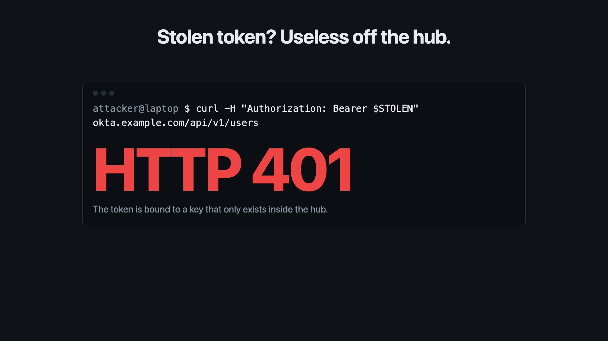

# IntegrateX

**A config-driven security integration platform: one YAML file per source, one engine for all of them, built for the day the hub itself is breached.**

Mitigata CyberForge · Problem Statement 05

[](docs/media/integratex-demo.mp4)

▶ **[Watch the 22-second demo](docs/media/integratex-demo.mp4)** · [Pitch deck](docs/IntegrateX.pptx) · [Demo script](docs/DEMO.md)

---

## The problem we solve

| Problem | What IntegrateX does |
|---|---|
| Every new tool needs weeks of custom code | A new source is **one YAML file**. No code change. |
| Integrations break or behave differently under failure | **One engine.** Every connector gets the same retries, rate limits, quarantine and health. |
| Bad or partial data is silently trusted | **Staged syncs.** Nothing is published until the whole sync is verified, and every sync leaves a signed receipt. |
| **The hub holds the keys to everything** (the 2025 Salesloft Drift breach: stolen OAuth tokens replayed against hundreds of companies) | **A breached hub gives up as little as possible, and the breach is detected in minutes.** |

## Core innovation

1. **Credential broker.** One isolated process holds every secret, encrypted. Workers never see a credential; they ask the broker to make the call.
2. **Sync Integrity Receipts.** Every sync is staged, judged (`verified` / `held` / `rejected`) and published atomically. Its receipt is hash-anchored in a tamper-evident ledger.
3. **Breach detection.**
   - **Canaries:** decoy secrets that raise an alarm, with the caller's IP, when used.
   - **Foreign-IP detection** from the provider's own audit log.
   - **Incident mode:** audit logs poll every 2 min instead of 15.
4. **Token binding.** DPoP-bound OAuth tokens: a stolen token is useless off the hub.
5. **Incident advisor.** Fixed rules decide whether to recommend the kill switch. An LLM (Claude, or Groq) explains why, and every claim must cite evidence.
6. **One-click kill switch.** Disables everything, cancels runs and revokes tokens at the provider.
7. **Capability registry.** For every connector and every security control: enforced, available, unsupported or not applicable.

---

## PRD coverage

### Must have: what a config describes

| ID | Requirement | Status | How |
|---|---|---|---|
| FR-1 | Authentication | ✅ | `api_key`, `basic`, `bearer`, `oauth2_client_credentials` (secret or `private_key_jwt`, optional DPoP), `none` |
| FR-2 | Endpoints | ✅ | `request: { method, path, params }`, with `${env.X}` interpolation |
| FR-3 | Pagination | ✅ | 6 styles: `link_header`, `cursor`, `offset`, `page_number`, `body_link`, `none` |
| FR-4 | Schedule | ✅ | `schedule: { every: 15m, jitter: 60s, incident_every: 2m }` |
| FR-5 | Mapping | ✅ | `path`, nested values, `concat`, `const`, `pick`, plus transforms such as `to_iso8601`, `from_epoch_ms`, `lowercase`, `cvss_to_severity` |

### Must have: what the platform provides

| ID | Requirement | Status | How |
|---|---|---|---|
| FR-6 | Safe secrets | ✅ | Envelope encryption (AES-256-GCM) in the broker. Values are write-only, and a leak check is included. |
| FR-7 | Retries with backoff | ✅ | Exponential backoff on timeouts and 5xx, plus a circuit breaker |
| FR-8 | Rate limits | ✅ | Slows down on 429, honours `Retry-After`, and applies a per-connector token bucket |
| FR-9 | Bad data handling | ✅ | Failed records are quarantined with reasons; the run continues |
| FR-10 | Health view | ✅ | Dashboard and `GET /v1/health`: status, last run, records, last error, next run |
| FR-11 | One store | ✅ | Postgres `users` / `devices` / `events`, each with `source` and `fetched_at` |

### Bonus

| ID | Feature | Status | How |
|---|---|---|---|
| B-1 | Incremental sync | ✅ | `incremental:` cursor; the watermark moves only after a verified sync |
| B-2 | Config validation | ✅ | `ix validate`: line-numbered errors and policy warnings |
| B-3 | Test connection | ✅ | `ix test` and a dashboard button: auth, first page, 3 mapped records, writes nothing |
| B-4 | Alerts | ✅ | Slack alerts for failure streaks, auth failures, drift, breaker, canary and foreign IP |
| B-5 | Web form | ✅ | Dashboard **＋ Add connector** builder generates and validates the YAML |

### Sources connected

| Source | Auth | Paging |
|---|---|---|
| GitHub (members, issues) | Bearer PAT | Link header |
| Okta (users, system log) | SSWS API key / OAuth2 | Link header cursor |
| NVD CVE | API key | Offset |
| CISA KEV | None | None |
| Elastic Security | API key | Offset (`from`/`size`) |

Coverage configs for CrowdStrike, Trend Vision One, Netskope and FortiGate are in [connectors/coverage/](connectors/coverage/).

---

## Setup

Requires **Node ≥ 22.19** and **Postgres 16**.

```sh
npx pnpm@10.28.0 install
cp .env.example .env
cp .env.broker.example .env.broker     # IX_MASTER_KEY=$(openssl rand -base64 32)
cp .env.admin.example .env.admin       # IX_BROKER_ADMIN_TOKEN=$(openssl rand -hex 24)
chmod 600 .env .env.broker .env.admin
createdb integratex
npx tsx src/store/migrate.ts

npx pnpm@10.28.0 dev                   # broker + API + scheduler + worker
open http://localhost:7070             # dashboard
alias ix="npx tsx src/cli/ix.ts"
```

If HTTPS fails on Homebrew Node: `export NODE_EXTRA_CA_CERTS=/opt/homebrew/etc/ca-certificates/cert.pem`

---

## Add a new connector (example: CISA KEV)

**1. Write the config:** [connectors/cisa-kev.yaml](connectors/cisa-kev.yaml)
```yaml
apiVersion: ix/v1
kind: Connector
metadata: { id: cisa-kev, source: cisa_kev, tenant: demo }
connection:
  base_url: https://www.cisa.gov
  auth: { type: none }
streams:
  - name: kev
    entity: event
    request: { method: GET, path: /sites/default/files/feeds/known_exploited_vulnerabilities.json }
    records_path: vulnerabilities[*]
    pagination: { type: none }
    mapping:
      id:          { path: cveID, required: true }
      type:        { const: known_exploited_vulnerability }
      severity:    { const: critical }
      timestamp:   { path: dateAdded, transform: to_iso8601 }
      description: { concat: [vendorProject, { lit: " " }, product, { lit: ": " }, vulnerabilityName] }
schedule: { every: 24h }
policy: { allowed_hosts: [www.cisa.gov], methods: [GET], max_records_per_run: 5000 }
```

**2. Validate, test, add, run:**
```sh
ix validate connectors/cisa-kev.yaml      # line-numbered errors, if any
ix test connectors/cisa-kev.yaml          # live call, 3 mapped records, writes nothing
ix add connectors/cisa-kev.yaml           # the broker validates and signs it
ix run cisa-kev                           # → success, decision: verified
ix receipts cisa-kev                      # Sync Integrity Receipt
ix query events --source cisa_kev         # data in the common schema
```

**For a source that needs a key,** store the secret first: `ix secret set <name>` (hidden prompt). The config refers only to the name.

**Or use the dashboard:** **＋ Add connector** → fill in the form → **Validate** → **Test** → **Save**.

---

## Kill switch

**Rehearse first (changes nothing):**
```sh
ix rehearse
```

**Trigger it:**
- **Dashboard:** click **Kill switch** and enter the admin token, or
- **CLI:** `ix panic --yes`

**What happens:**
1. Every connector is disabled.
2. Queued and running jobs are cancelled.
3. OAuth tokens are revoked at the provider (RFC 7009) and wiped from broker memory.
4. A checklist lists what only a human can revoke (PATs, API keys).
5. Everything is recorded in the audit ledger. The app's database role cannot undo it.

**Verify and restore:**
```sh
ix audit verify                 # hash chain intact
ix enable <connector-id>        # re-enable one at a time, through the broker
```

**When to use it:** run `ix advise` (or the dashboard's **Advisor** button). It recommends the kill switch on critical signals: a canary fired, or our credential used from a foreign IP.

---

## Demo: the breach story (5 min)

The full script with talking points is in [docs/DEMO.md](docs/DEMO.md). It runs locally against the mock provider; no internet is needed. [test/demo-rehearsal.test.ts](test/demo-rehearsal.test.ts) runs the same story on every test run.

**Setup:**
```sh
MOCK_REQUIRE_DPOP=1 MOCK_PORT=4010 IX_EGRESS_IPS=198.51.100.10 npx pnpm@10.28.0 dev:mock
MOCK_PORT=4010 ix add test/fixtures/configs/mock-okta-dpop.yaml
MOCK_PORT=4010 ix add test/fixtures/configs/mock-okta-logs.yaml
ix secret set mock_client_id; ix secret set mock_client_secret; ix secret set mock_ssws
ix run mock-okta-dpop; ix run mock-okta-logs
ix canary create okta_admin_token --prefix 00
ix canary create slack_webhook_prod --url --print
```

| Step | Action | What the audience sees |
|---|---|---|
| 1 | Dashboard | Green cards, syncs `verified`, receipts |
| 2 | **Capabilities** button | Each control per connector |
| 3 | Steal a token: `curl localhost:4010/__dpop/stolen`, then replay it | **401**: the token is DPoP-bound |
| 4 | Call the looted webhook URL | **Red canary banner** with the attacker's IP, and incident mode on |
| 5 | `curl "localhost:4010/__attack?ip=203.0.113.7"`, then `ix run mock-okta-logs` | **`foreign_ip_use`** alert from the provider's own log |
| 6 | **Advisor** button | **Kill switch recommended**, with cited evidence |
| 7 | **Kill switch** | All disabled, token revoked, `ix audit verify` passes |

---

## Commands

| Command | Purpose |
|---|---|
| `ix validate` / `ix test` / `ix add` / `ix update` | Config lifecycle |
| `ix run <id>` / `ix runs <id>` | Sync now / run history |
| `ix secret set` / `ix secret list` | Write-only secrets |
| `ix query <entity>` / `ix quarantine` | Data / rejected records |
| `ix receipts` / `ix receipt` / `ix held` / `ix approve` / `ix discard` | Integrity receipts and held syncs |
| `ix posture` / `ix capabilities` | Security posture per connector |
| `ix canary create` / `ix canary list` | Decoy credentials |
| `ix incident start` / `stop` / `status` | Incident mode |
| `ix advise` | Incident advisor (AI key: `ix secret set anthropic_api_key` or `groq_api_key`) |
| `ix rehearse` / `ix panic --yes` / `ix enable` | Kill switch |
| `ix audit verify` / `ix audit log` | Tamper-evident ledger |

---

## Architecture

```
 YAML configs ──► Broker (only secret holder) ──► Provider APIs
                    │  signed configs · host allow-list · DPoP · canaries · audit ledger
                    ▼
 Scheduler ─► Queue ─► Worker (engine: paging, retries, mapping)
                         │
                         ▼
                 Staging ─► integrity check ─► users / devices / events + receipt
                         │
                         ▼
            API + dashboard · alerts · advisor · kill switch
```

| Path | What |
|---|---|
| [connectors/](connectors/) | Real source configs |
| [src/broker/](src/broker/) | Secrets, auth, OAuth, DPoP, canaries, policy, ledger |
| [src/engine/](src/engine/) | Runner, pagination, integrity, receipts |
| [src/security/](src/security/) | Posture, capabilities, incident mode, advisor, kill switch |
| [src/api/](src/api/) | API and dashboard |
| [docs/DETAILS.md](docs/DETAILS.md) | Full technical reference |

**Provider-neutral engine:** `grep -riE "github|okta|nvd|cisa" src/engine src/broker` prints nothing.

## Quality

```sh
npx pnpm@10.28.0 test        # 227 tests, including the end-to-end demo rehearsal
npx pnpm@10.28.0 lint
npx tsc --noEmit
```
